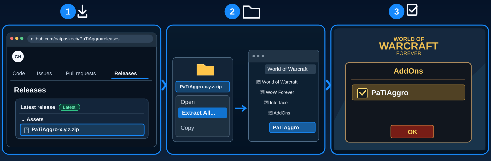

# PaTiAggro


## Install

**📥 [Download PaTiAggro Beta](https://github.com/patpaskoch/PaTiAggro/releases/download/v0.1.0-beta.1/PaTiAggro-0.1.0-beta.1.zip)** · [Installation guide](#installation)

*Installation-test preview — not yet a stable release.*

## What is PaTiAggro?

**Don't let a loose enemy turn a good pull into a wipe.**

Whether you're tanking, healing or dealing damage, knowing who has aggro makes all the difference. PaTiAggro shows when enemies are slipping away, when you're about to pull threat and where your attention is needed. **Stay ahead of the chaos.**

## Features

- **For every role:** Dedicated tank, healer and damage views.
- **Threat at a glance:** See who has aggro and who is close to pulling.
- **Protect your group:** Spot enemies you've lost or are about to lose as a tank.
- **Find the right enemy:** Match warning numbers to visible enemy nameplates.
- **You're in charge:** No automatic targeting or taunting.

## Installation



1. 📥 **Download** – Open [GitHub Releases](https://github.com/patpaskoch/PaTiAggro/releases) and download the `PaTiAggro-<version>.zip` file under **Assets** (not **Source code (zip)**).
2. 📂 **Extract & Copy** – Right-click the ZIP, select **Extract All**, then copy the extracted `PaTiAggro` folder into the WoW Forever client's `Interface/AddOns/` folder. No renaming is needed.
3. ☑️ **Enable in Game** – Start WoW, open the **AddOns** menu at character selection, tick **PaTiAggro**, and click **OK**.

💡 **Tip – Find your WoW installation folder:** In the **Battle.net launcher**, select your WoW version, click the **gear icon next to Play**, and choose **Show in Explorer** (*Im Explorer anzeigen*). This opens the game's installation location in **Windows File Explorer**. From there, open `Interface/AddOns/` (or choose the correct WoW version folder first, if needed).

## Getting Started

- `/paggro test` shows the display with example enemies — the tank view or, with "My role" set to Healer or Damage,
  the healer/damage view
- Turn on enemy nameplates (default key V) so PaTiAggro sees more than your target
- `/paggro` shows or hides the window
- A red row `1 Kultist → Healer` appears: click the nameplate showing a red "1" to target that enemy

## Settings

`/paggro settings` or ••• → Settings: language, my role, scale, window lock, numbers on nameplates on/off (off: no
numbers at all).
- **Window:** panel opacity (30–100 %)

## Feature details

- **My role** (Settings): Auto, Tank, Healer or Damage. Auto uses the role WoW reports for you in the group; without
  one, but with another member assigned as tank, it shows your own threat; without any role it shows the tank view.
  Never guessed from your class — as healer or damage without group roles, set "My role" once (saved per character).

The window has three sections, top to bottom, with clear space between them:

```
5 / 6  AGGRO TOTAL

AGGRO TARGET  Test enemy
[ Brom (Tank)              has aggro ]   green: the right one has it
[ Lyra (Damage)                 84 % ]   yellow from 70 %, red from 90 % (100 % = they take it)
[ Mira (Healer)                 35 % ]


AGGRO TEAM
▌1 Ghoul                Mira (Healer)    red: Mira has it
▌2 Zombie               Lyra (Damage)    yellow: you still hold it, Lyra is about to take it
```
The section names are small captions in the accent colour, like PaTiHeal's "TARGET" mark. Only sections with
content are shown: no AGGRO TOTAL without enemies, no AGGRO TARGET without an enemy target, no AGGRO TEAM without rows.

**AGGRO TOTAL**
- Tank: how many of the enemies your group fights you hold (`5 / 6`)
- Healer/damage: your highest threat over your target and every enemy the group fights (healing threat lands on all
  of them) — white below 70 %, yellow from 70 %, red from 90 %. An enemy that attacks you shows only in
  AGGRO TARGET (the red "has aggro" bar), not a second time here

**AGGRO TARGET** — the caption with your target's name above the bars
- As healer or damage: **"not the tank's target"** in yellow on the right when you have another enemy targeted than
  the tank (the tank is the member with the WoW role Tank). Only a hint — nothing is targeted for you
- You and every group member (and pet) on its threat list, sorted: who has the aggro first, then by percent
- Each as `Name (Role)` — the role when WoW assigned one, else the class
- The one who has it shows "has aggro": green when that is right (you as tank, or the tank when you are not),
  red when not. Everyone else shows how far they are to taking it (100 % = they pull it). An enemy nobody attacked
  yet shows you with 0 %

**AGGRO TEAM** (tank only)
- Tank: up to four enemies that need you — red = lost, with `Name (Role)` of who has it; yellow = you still hold it
  but `Name (Role)` is about to take it ("slipping" when WoW does not say who); grey = unclear.
  Unreadable data is shown as "unclear", never as held
- With **PaTiAlerts** installed (optional), the tank's lost and slipping rows also appear there, with the same number

**Both views**
- Enemies come from your target, visible nameplates and your party's targets
- **Numbered nameplates:** every AGGRO TEAM row gets a number (`1 Ghoul`), and the same number stands above
  that enemy's nameplate — red = lost, yellow = barely held, grey = unclear. Two enemies with the same name
  are told apart by their number. Click the nameplate with that number to target the enemy.
  PaTiAggro never targets or taunts on its own
- A row without a number has no nameplate that can be named safely right now (e.g. the enemy is off screen) —
  PaTiAggro shows no number rather than a wrong one
- ••• menu: Settings, Lock, Collapse, Test Mode, Hide. Settings: language, my role, scale, lock.
  Languages: English, Deutsch (others fall back to English)

## PaTiSuite

This addon is part of the **PaTiSuite** — a collection of small addons for World of Warcraft: Forever.
Each one is installed on its own and works on its own; none of them is needed by another.

- [PaTiSuite](https://github.com/patpaskoch/PaTiSuite) – optional control panel to show and hide the PaTi windows
- [PaTiHeal](https://github.com/patpaskoch/PaTiHeal) – healing: party frames, heal target, click casting, HoTs, dispels
- [PaTiAuras](https://github.com/patpaskoch/PaTiAuras) – buffs, procs, tracking, group buffs and weapon imbues
- **PaTiAggro** – aggro for tank, healer and damage *(this addon)*
- [PaTiRota](https://github.com/patpaskoch/PaTiRota) – your own skill priority with cooldowns and fixed cast buttons
- [PaTiGroup](https://github.com/patpaskoch/PaTiGroup) – party awareness: tank, healer, roles and the tank's target
- [PaTiLead](https://github.com/patpaskoch/PaTiLead) – lead the group: raid markers, ready check and pull timer
- [PaTiQuest](https://github.com/patpaskoch/PaTiQuest) – selected quest and its objectives
- [PaTiDungeon](https://github.com/patpaskoch/PaTiDungeon) – dungeon overview and a hand-drawn map for each instance
- [PaTiSocial](https://github.com/patpaskoch/PaTiSocial) – "Party Social": quick emote and message buttons
- [PaTiAlerts](https://github.com/patpaskoch/PaTiAlerts) – one window for open problems

### Goes well with (optional)

- [PaTiAlerts](https://github.com/patpaskoch/PaTiAlerts) – lists enemies you lost or barely hold (tank view), with the same number as the panel and the nameplate
- [PaTiLead](https://github.com/patpaskoch/PaTiLead) – manual group tools: raid markers, ready check, pull timer
- [PaTiSuite](https://github.com/patpaskoch/PaTiSuite) – shows and hides this window together with the other PaTi windows

## Commands

`/paggro` or `/patiaggro` (also `/pt`) — alone: show/hide · `settings` · `test` ·
`show` · `hide` · `lock` · `unlock` · `reset` (position) · `debug` (threat APIs, your role and the view) · `version`

## Known limitations

- Enemies without a visible nameplate that nobody in your group targets are not seen — for a healer without a
  target that means: turn on enemy nameplates.
- The rows in the panel are not clickable: WoW does not let an addon decide in combat which enemy a click targets.
  Click the numbered nameplate instead.
- Numbers need visible enemy nameplates; forbidden nameplates are left alone. Numbers 1–4 (the visible rows).
- The healer/damage view sends nothing to PaTiAlerts yet.
- The threat APIs are not yet confirmed in the Forever client.

## Development

Architecture, tests and engineering rules of the suite: [PaTiAdmin](https://github.com/patpaskoch/PaTiAdmin). PaTiAdmin is not a WoW addon — players do not install it. The shared UI code (PaTiShared) is already embedded in this addon's `Shared/` folder; there is nothing extra to install.

## Support

PaTiAggro is free and open source, and it stays that way. If it makes your runs a bit better, you can buy me a coffee:
[ko-fi.com/patiaddons](https://ko-fi.com/patiaddons). Bug reports and ideas are just as welcome:
[Issues](https://github.com/patpaskoch/PaTiAggro/issues).

## License

MIT — see [LICENSE](LICENSE). Copyright (c) 2026 Patrick Koch.
